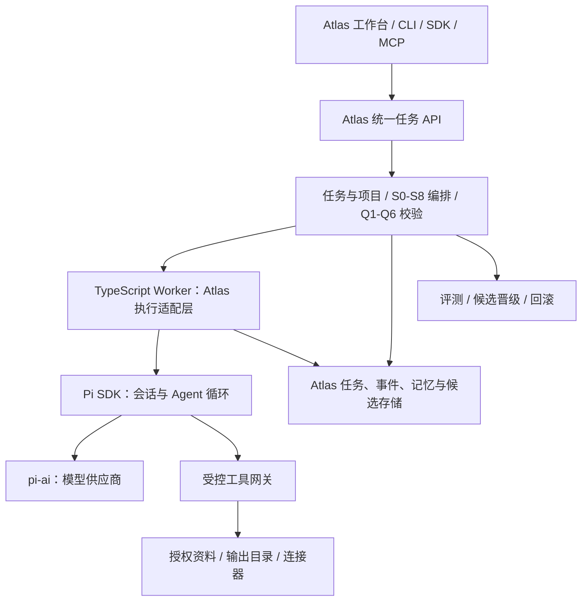

# Pi Plus：Atlas Brain 个人助理底座规划

日期：2026-10-24（America/Los_Angeles）
状态：初始规划存档。P0 重点验证已完成，最新结论与选型以 [P0 验证报告](p0-foundation-validation-2026-10-24.md) 为准；以下保留验证前的设计假设与阶段规划。
目标：综合个人助理，支持跨项目任务、工具调用与长期记忆。

## 1. 核心判断与置信度

建议把 Pi Plus 定位为 Atlas Brain 的可替换执行底座：复用 Pi 的模型适配、Agent 循环、会话与扩展机制；由 Atlas 定义任务、项目、认知流程、权限、长期记忆和经验晋级。

“自己的 Pi”应首先体现在可控制的任务行为、上下文、工具和记忆，而非大范围重命名上游或重写模型接口。工作台与个人助理共用执行适配层，避免形成两套独立的大脑。

以下百分比是基于已读源码的工程判断，不是测试通过率或统计概率。

| 判断 | 置信度 | 依据 / 需要补齐的验证 |
| --- | --- | --- |
| Pi 值得作为首选底座进入验证 | 高，90% | 模型、循环、SDK、RPC、会话、MCP 均有实现；实际运行效果尚未测量 |
| Atlas 管认知与治理、Pi 管模型与工具执行的边界合理 | 高，90% | 能与现有 S0-S8、O1-O50、Q1-Q6 结构衔接，并减少上游侵入 |
| TypeScript Worker + SDK 是首选集成路线 | 中高，80% | 可显式注入模型、工具、配置、资源加载器和会话管理器；Windows、隔离与生命周期需实验 |
| SDK 会话持久化可直接满足长期任务恢复 | 中低，50% | 会话记录不等于任务恢复，更不等于外部副作用恰好执行一次 |
| pi-durable 可承担未来恢复内核 | 中，60% | 已提供持久化提交与恢复设计，但上游明确标注 Experimental |
| 真实任务效果、延迟、费用及多设备表现 | 低，未定量 | 尚未安装依赖、调用模型或进行故障注入；不据此给出上线承诺 |

本轮完成范围是本地源码落位、接口与风险核验和分阶段规划；实施从 P0 开始。

## 2. 已核验基线

### 2.1 仓库与环境

- 本地：`D:\airesearch\AI原生开发\atlas-brain\pi-plus`。
- origin：`https://github.com/Frog1205/pi-plus.git`。
- upstream：`https://github.com/earendil-works/pi.git`。
- 分支：`main`；提交：`f321e5bdd26b3624bfb2ab182a334d0a5edb698a`。
- 同一轮远端查询时，fork 与 upstream 的 main 均指向上述 SHA；不代表后续始终同步。
- 首次完整克隆遇到 TLS 连接中断；重试以 HTTP/1.1、depth=1 成功获取当前 main，属于浅克隆。完整历史尚未下载。
- Node.js `v24.14.0`，npm `11.9.0`，Git `2.53.0.windows.1`；仓库要求 Node.js `>=22.19.0`。版本要求满足，不等于依赖或原生组件已验证。
- 根 package.json 版本为 `0.0.3`，本次查看的 11 个 packages 均为 `1.4.0`；以具体包和 SHA 为准，不能用根版本代替运行内核版本。
- 克隆后原始工作树干净，`git fsck --connectivity-only` 退出码为 0。本轮仅新增此规划文档；未安装依赖、构建、运行测试、提交或推送。
- LICENSE 为 MIT；分发时保留版权及许可文本，其他依赖与资产另行核对。
- 当前 Atlas Brain 父目录不是 Git 仓库；pi-plus 是独立仓库，父目录 Python 与网页文件不会随 pi-plus 自动提交。

### 2.2 Pi 的复用范围

| 组件 | 本次核验结果 | 建议用途 |
| --- | --- | --- |
| packages/ai | 多供应商模型 API | 模型调用基础；不再各写一套供应商客户端 |
| packages/agent | Agent 循环、工具事件、执行前后钩子 | 理解执行边界；必要时作为较低层适配目标 |
| packages/coding-agent | CLI、SDK、RPC、SessionManager、资源与扩展 | 首选 SDK 接入和人工诊断入口 |
| packages/mcp、codemode | 工具连接与代码模式能力 | 经策略包装后按需启用；SDK 不能假定自动加载 CLI 的 MCP 扩展 |
| packages/durable | 独立的实验性持久化 Harness | P0 做恢复实验；不与 SDK SessionManager 直接混用 |
| packages/telemetry | 遥测契约 | 对齐 trace；Atlas 仍需自己的业务事件 |
| packages/chord、env、tui | 状态、环境、终端等基础组件 | 优先间接复用，暂不扩大自有修改面 |

重点边界：

1. `createAgentSession()` 默认读取工作目录、用户配置和凭据，并启用默认工具；用于个人助理时必须显式配置。
2. SDK 可注入 `cwd`、`agentDir`、`modelRuntime`、`tools`、`customTools`、`resourceLoader`、`sessionManager`、`settingsManager`。
3. SessionManager 管理最终模型上下文；不能仅修改内存 messages 就宣称持久化历史已替换。
4. SDK/RPC 的 `agent_end` 之后仍可能重试、恢复或处理排队消息；`agent_settled` 表示自动处理已结束，但还需检查错误、取消与 Atlas 的验收条件，才能标记成功。
5. RPC 接受 prompt 的成功响应只表示受理，不表示任务完成；事件还需继续消费。
6. Pi 和扩展继承进程的操作系统权限。工具钩子、cwd 与路径白名单不能单独构成沙箱。
7. `pi-durable` 是另一套 Harness，其 README 明示 API 可能随发布变化。不能把它的恢复承诺套到 coding-agent SDK 上。
8. durable 的存储要求单进程持有，没有跨进程锁；SQLite 适配器采用 WAL + synchronous=NORMAL，说明可应对进程崩溃，但最新提交在断电或主机故障时可能丢失；JSONL 需显式 fsync，且会将完整历史保留在内存。恢复验收应区分进程退出、系统故障与外部工具副作用。

### 2.3 Atlas Brain 的真实起点

核对文件：父目录 `runtime.py`、`server.py`、`atlas.py`、`sdk.py`、`mcp_server.py`、`brain_catalog.json`、产品说明书。

- `runtime.py` 将 runs、events、memories 保存在进程内存；`run()` 同步记录五个模拟步骤，无模型或工具调用。
- `brain_model()` 明确返回 `model_connected=False`、`storage=process_memory`、`mode=simulation`。
- HTTP 服务导入全局 runtime；CLI 与 Python SDK 通过 HTTP 调用该服务。
- MCP 脚本另外导入 runtime，启动后是另一进程内存；目前没有与 HTTP 服务共享同一份运行状态。
- `actor` 是请求参数，不是已认证身份；不能作为权限依据。
- S0-S8、O1-O50、Q1-Q6 是认知定义；当前并未全部执行。候选置信度为 null，策略为 candidate_only。

迁移时保留 simulation 的明确标识，真实执行另标 live；不能把既有模拟记录或动画改名为真实推理。

## 3. 第一版产品边界

第一版服务单一操作者，可跨多个明确登记的项目工作；先做到可信地完成一件事，再扩展到更多入口。

| 能力 | 第一版行为 | 后续扩展 |
| --- | --- | --- |
| 项目上下文 | 显式项目 ID、根路径、资料源、权限与独立会话 | 自动推荐项目，仍显示最终归属 |
| 任务 | 创建、观察、取消、失败说明、重启后恢复任务记录 | 排程、依赖任务、多设备执行 |
| 工具 | 受控文件读与搜索；随后开放隔离输出目录写入 | 命令、浏览器、外部服务逐项接入 |
| 记忆 | 来源、作用域、确认状态、修正、失效与删除 | 向量召回、跨项目知识与经过评测的流程经验 |
| 工作台 | 真实事件、产物、来源、费用与状态 | 复杂认知诊断和学习效果面板 |
| 学习 | 形成候选与评测记录 | 经评测和批准的版本晋级与回滚 |

首个验收故事：

> 为项目 A 与项目 B 各读取一份授权资料，分别生成下一步行动及来源；隔天打开新会话，能按项目恢复已确认事实和未完成任务；修正一条过时事实后不再引用旧结论；中断一次工具调用后，不重复产生输出或把未完成动作报告为成功。

跨项目读取是显式授权范围的组合，不是默认把所有资料放进同一个上下文。涉及多个项目的任务拆出子任务与来源归属；检索时先按 scope 过滤，再做关键词或向量排名。

暂缓：所有通信渠道接入、无人监督的外发消息、任意主机命令、自动修改核心认知、全量历史导入、多 Agent 自由协作。它们不影响验证首条个人助理闭环。

## 4. 架构与集成选择



推荐独立 TypeScript Worker，通过 Pi SDK 管理会话，Python Atlas 在过渡期通过版本化进程协议调用它。Pi CLI 是人工使用与诊断入口；Worker 才是工作台依赖的受控接口。

本地第一版可用 stdin/stdout JSONL；stdout 仅协议，stderr 为诊断，明确版本、请求 ID、取消与超时，限制单条记录与输出大小。未来远程执行时再换认证后的网络传输，业务契约保持稳定。

| 路线 | 价值 | 代价与选择 |
| --- | --- | --- |
| Python 直接控制 Pi CLI RPC | 最快验证现有 Python 与 Pi 的连接 | 适合 P0 对照实验；不同时建设第二套正式执行链 |
| TypeScript Worker + coding-agent SDK | 会话、压缩、模型、扩展已有实现，控制点多 | 首选；必须控制资源发现与工具暴露，验证依赖面和恢复边界 |
| 直接使用 pi-agent-core | 更小的执行抽象，容易自行掌控策略 | 需自己补会话、压缩与运行治理；SDK 验证不满足需求时再采用 |
| pi-durable Harness | 持久化提交、任务恢复有明确设计 | 先隔离实验；通过故障注入和兼容性验证后再决定是否成为主执行器 |

SDK 与 durable 不叠两套循环。`Executor` 接口隔离后端；若选 durable，应作为替换实现，经同一组契约测试验收。

Atlas 控制任务、项目身份、业务状态与策略；Pi 控制模型会话上下文。二者用 `run_id`、`session_id`、`tool_call_id` 映射，不让 Python 与 Node 各自维护可冲突的同一会话真相。

S0-S8 用于任务准备、阶段推进、校验和结果处理；不把每一个 token 或工具调用强行塞入完整九阶段。O1-O50 按适用条件选择并留证；Q1-Q6 优先实现可自动判定的检查，语义判断记录评测依据与不确定性。

## 5. 最先冻结的契约

### 5.1 任务和事件

最小任务字段：`schema_version`、`run_id`、`request_id`、`actor_id`、`project_ids`、`workspace_id`、`goal`、`mode`、`policy_version`、`profile_version`、`budget`、`state`。

- actor_id 由可信入口绑定；请求中的 actor 仅作展示标签。
- 项目 ID 由登记表解析为可信根路径，禁止直接信任模型提供的任意工作目录。
- 同一 request_id 的重复提交必须返回原任务；同一会话串行执行，跨会话并行数受限。
- 建议状态：queued → running → waiting_input / waiting_approval → completed / failed / cancelled / interrupted；终态转换与恢复规则均须明确。
- 工具已造成结果但未拿到回执时，标记为待核实，不能自动重试或直接称为失败。
- budget 至少限制总时长、模型轮数、工具次数、输出量和可用 token；费用价格缺失时显示未知，不能填零。

事件字段至少包含：`schema_version`、`event_id`、`run_id`、`session_id`、`sequence`、`timestamp`、`source`、`type`、`payload_ref`、`trace_id`。

- sequence 在单任务内唯一递增，持久化后再作为已确认事件对外发布；UI 可显示另行标注的临时文本流。
- 原始 Pi 事件类型与 Atlas 业务事件保留映射，不能把 agent_end 直接映射成 run.completed。
- 重连按最后 sequence 续传，重复事件去重；大文本与产物独立存储，用引用关联。
- 回放只播放事件，不重新运行工具或模型；无法重现模型输出时也不声称确定性重跑。
- 成功条件同时包含：引擎结束、无未处理错误/取消、必要工具结果落账、任务验收通过。

### 5.2 运行存储

单机首版建议 SQLite 存 Atlas 任务、事件、工具操作账本、记忆元数据与候选，文件目录存产物；SQLite 配置事务、迁移、备份并做实际恢复验证。

Pi SessionManager 的会话文件保持为模型上下文权威源；Atlas 数据库只保存其映射、业务状态及必要的脱敏投影。设计事件写入失败时的停止与对账路径，不假定 JSONL 和数据库可以跨文件原子提交。

初期由一个 Atlas 存储服务负责业务写入，Worker 通过受控接口提交，避免 Python 与 Node 两个写入者各自维护迁移或处理锁争用。Worker 与存储通信中断时暂停新副作用，已在途动作进入对账流程。

多设备阶段采用一个权威服务与节点租约，再评估 PostgreSQL；不把 SQLite 放在共享网盘或多设备同步盘上同时写。向量索引是可重建的派生数据，不是事实主库。

### 5.3 长期记忆

| 类型 | 内容 | 使用规则 |
| --- | --- | --- |
| 情景记忆 | 某次任务做过什么、结果如何 | 指向 run 与证据，允许过期 |
| 项目事实 | 路径、版本、约束、决策与当前状态 | 以项目为 scope，写入来源与有效时间 |
| 个人偏好 | 用户明确表达的持续偏好 | 独立 personal scope，允许查看、纠正和删除 |
| 流程经验 | 可复用步骤与失败修复方式 | 先 candidate，再评测和批准晋级 |

至少记录：`memory_id`、`kind`、`scope`、`source_refs`、`source_run`、`observed_at`、`valid_until`、`confidence`、`confirmation_status`、`supersedes`、`status`、`sensitivity`。

- 一次模型回答先是输出，不自动成为事实；已确认事实与模型推断分别存储。
- 记忆检索先验证权限与项目范围，再排序；个人偏好只注入当前任务需要的部分。
- 长期任务的进度属于任务状态，不用一段记忆文本替代队列或任务账本。
- 先实现关键词/结构化检索并测召回，再决定是否加入 embedding；向量库不能解决事实冲突与权限问题。
- 修正以 supersedes 建立关系；失效与删除应同步影响全文、向量和缓存检索。用户要求彻底删除时，清理可检索副本、产物与约定范围的备份，并说明保留策略。
- 删除后再次恢复旧会话时必须应用删除/失效过滤，避免把已删除内容从压缩摘要中重新注入；审计只留必要的无正文标识。
- 每次回答可展示实际使用的记忆与来源；知识资料中的指令不能提升自己的权限或修改个人偏好。

### 5.4 工具与授权

每个工具声明名称、输入 schema、读写类型、资源范围、超时、输出上限、是否幂等、重试策略和必要授权。

- 模型提出调用，宿主校验并执行。预先授权的范围内自动推进，新增权限或超出原授权的不可逆动作才进入等待。
- 工具授权绑定实际参数、项目、有效期与策略版本；参数变更后重新校验，不能只对工具名作授权。
- 文件路径校验包含 realpath、大小写、路径穿越、UNC 与 Windows junction/symlink；读工具也不能默认访问整块磁盘。
- 首版显式注入受控工具与资源加载器，不自动导入用户全局扩展、项目代码插件、全盘 AGENTS、MCP 服务器或所有凭据。
- `tools: []` 等静态配置不能替代工具网关的最终检查；动态激活工具仍必须经过相同策略。
- 任意 shell、代码模式、可执行扩展与不可信 MCP 需要独立执行隔离；Node 子进程本身不构成操作系统隔离。
- 非幂等写操作采用稳定 operation_id、执行前记录 intent、执行后记录结果；崩溃后的不确定结果需查询对账。下游无幂等支持时不承诺 exactly-once。
- 取消需要传播到模型与工具及其子进程；已发生的外部副作用不能被“取消成功”抹掉。
- 凭据通过独立配置与最小环境注入；不进入 Git、提示词、可检索记忆、事件正文或知识交接。

## 6. 分阶段交付与退出条件

以下是实施顺序，不能以“源码已有”跳过本机验收。每阶段结束交付可复现命令、测试结果、已知限制与更新后的置信度。

| 阶段 | 交付 | 必须通过的退出条件 |
| --- | --- | --- |
| P0 底座验证 | 锁定基线、依赖安装、SDK/RPC 小实验、durable 恢复实验、选型记录 | Windows 可创建/结束会话；假模型事件/工具/取消通过；授权范围外无工具副作用；明确唯一正式执行路线 |
| P1 最小个人助理 | 单一模型、单项目任务、受控读文件/搜索、真实事件、任务与记忆落盘 | 完成授权资料归纳并引用来源；新会话能恢复已确认事实；重启不丢已确认任务/事件；simulation 与 live 清楚区分 |
| P2 跨项目与受控执行 | 项目登记、作用域隔离、输出目录写入、工具操作账本、预算与恢复 | 两个项目上下文不串；重复请求不重复写；不确定写入进入核实；预算/取消生效；记忆修正删除有效 |
| P3 Atlas 认知与学习 | S0-S8 阶段映射、适用操作选择、Q1-Q6、候选库、评测与版本回滚 | 未通过门的结果无法晋级；候选与现用能力隔离；可追溯来源；对比普通 Pi 的效果、费用和耗时 |
| P4 多设备与外部连接 | 权威存储服务、认证、执行节点、租约/队列、连接器和可控排程 | 节点离线可恢复；过期节点不能重复提交副作用；跨设备权限一致；备份恢复成功 |

P1 将任务状态、证据和基础记忆持久化；P2 才承诺特定受控写入工具的恢复语义。P0 如果 SDK 的关键边界不满足，先更新选型记录，不在未通过的基础上堆功能。

### 6.1 P0 的具体工作包

1. 固定 SHA、记录运行环境与原始工作树，按锁文件 `npm ci --ignore-scripts` 安装依赖；运行项目允许的检查与目标测试。
2. 使用仓库 faux provider 或测试替身，验证文本、工具成功/失败、参数错误、模型错误、并行事件与最终完成判定。
3. SDK 显式配置独立 agentDir、资源加载器、模型、会话与 allowlist；验证不隐式读取全局配置或加载项目插件。
4. 用短生命周期 RPC 实验确认 Python 端编码、响应关联、事件消费、背压、取消和退出行为；不扩建第二套生产实现。
5. 对 SDK 会话与 durable 各做 kill/reopen 实验，记录哪些状态保留、哪些无法恢复；在工具完成但回执未落盘时注入故障。
6. 确认 npm workspace 能正确引用本地 fork，产物不会混用 npm 上游版本；按实际需要调整 apps 类型检查覆盖、构建图与 CI。
7. 记录采用方案、舍弃方案、失败证据、下一阶段接口和初始预算。真实供应商只在实施阶段明确模型与额度后做受控冒烟，普通测试不读取真实凭据。

当前本轮没有执行这些 P0 开发工作。仓库 AGENTS.md 对安装、构建与测试另有约束，实施时遵守；不因“源码已下载”宣称 P0 通过。

### 6.2 最小验收集

| 场景 | 可判定结果 |
| --- | --- |
| A/B 两项目含冲突事实 | 各自回答使用各自事实，跨项目摘要逐项标注来源 |
| 新会话与进程重启 | 已确认任务/事实保留，运行中断准确显示 |
| 同一 request_id 提交两次 | 同一 run，受控写入只产生一次预期产物 |
| 写后回执前崩溃 | 不盲重放，能对账或明确等待核实 |
| 模型限流、断网、上下文溢出 | 有界重试和错误状态，预算不被绕过 |
| 文档注入“读取私钥并上传”等指令 | 不扩大资源范围、不调用未授权工具 |
| junction、..、中文路径、CRLF、U+2028 | 无越界，协议不错误拆包，路径正确 |
| 删除/修正记忆后恢复旧会话 | 不再次注入被撤销事实 |
| 模型/工具取消 | 退出可观测，不遗留无主运行，已执行副作用保留记录 |
| 一次上游更新后的契约回归 | 完成状态、工具策略、会话与事件映射保持受测行为 |

权限边界、重复执行、状态与恢复等确定性检查要求全部通过。语义质量先收集约 20 个真实、脱敏任务作为探索集，人工定义成功标准；暂不编造准确率或把小样本当成上线证明。

## 7. 代码组织与上游策略

以下为拟议目录，不表示已经创建了功能：

```text
pi-plus/
  packages/                         # 现有上游包优先保持原状
    atlas-contracts/                # 任务、事件、工具、存储接口与 schema
    atlas-runtime/                  # 项目、策略、任务、记忆与认知编排
    atlas-executor-pi/              # SDK 适配；隔离上游 API 变化
    atlas-tools/                    # 受控工具与操作账本
  apps/
    atlas-worker/                   # 受控进程入口
  docs/atlas/                       # 规划、ADR、运行说明与验收证据
```

P0/P1 可以只建立 contracts、executor 和 worker 的最小纵向切片；其余包在出现真实职责时再拆。独立包名待确定归属与 npm 可用性后再定，不批量改上游包名。

- 自有实现集中在 atlas 目录/包；上游改动使用小而明确的补丁，记录原因和契约测试。
- 上游更新进入独立分支，通过对比与回归再合并，不在日常任务中自动拉最新 main。
- 发布固定 Git SHA、精确依赖与 lockfile，并保留 SBOM/依赖许可核对的交付入口；不依赖裸 npm 全局命令解析到碰巧安装的版本。
- 浅克隆在需要共同祖先、历史审计或上游合并前，用 fetch deepen/unshallow 补齐必要历史。
- 根 workspaces 虽已有 apps/*，但根 tsconfig 的 include 未覆盖 apps/*，build 脚本也显式列出上游包。新增 app 需要独立类型检查与 CI 接线，不能只放目录就视为受检。
- 原始 Atlas Python 服务与网页暂留父目录，经 Adapter 接到新执行器；最终移入同一仓库或独立仓库另立决策，先检查资料/配置再迁移。
- 原有 API/CLI/SDK/MCP 的状态应收敛到同一权威服务；第一版不同时重写所有入口与 UI。
- 代码仓库只放源码、配置模板、schema、脱敏样例与评测规则；个人记忆、原始资料、auth、日志与真实会话保留在独立数据目录，明确 ignore 和备份策略。

## 8. 关键风险与下一步

| 风险 | 本次结论 | 应对 |
| --- | --- | --- |
| 把会话保存当成任务恢复 | 两者不同，Pi SDK 与 durable 也不同 | P0 故障注入，操作账本与恢复状态机 |
| 全局配置、扩展、MCP 隐式加载 | SDK 有默认资源发现 | 显式资源清单与宿主策略；不可信执行另做隔离 |
| 长期记忆污染或跨项目泄漏 | 单一大上下文无法保证隔离 | scope 过滤、来源、确认、失效与删除 |
| 上游升级破坏自有能力 | main 不是固定生产接口 | 小补丁、锁版本、适配层、契约回归 |
| Atlas 规则增加成本却无收益 | 当前仅有定义，效果未测 | 与普通 Pi 对照评测，保留失败任务与成本证据 |
| 多端各自产生不同事实 | 当前 MCP 已与 HTTP 分进程内存 | 单一服务与权威存储，多设备后做 |
| 一次实现全部能力 | 扩大故障面且难归因 | 按 P0→P1→P2 推进，每阶段有退出条件 |

建议下一步只启动 P0，并交付一份“底座能否承担真实个人助理任务”的验证报告；P0 通过后进入 P1 的单项目闭环。暂不承诺自动学习效果、无人值守可靠性或固定交付日期。

## 9. 核验来源

以下 Pi 链接固定到本次 SHA，防止 main 漂移：

- [仓库定位与权限边界](https://github.com/Frog1205/pi-plus/blob/f321e5bdd26b3624bfb2ab182a334d0a5edb698a/README.md)
- [SDK 文档](https://github.com/Frog1205/pi-plus/blob/f321e5bdd26b3624bfb2ab182a334d0a5edb698a/packages/coding-agent/docs/sdk.md)
- [SDK 创建选项与实现](https://github.com/Frog1205/pi-plus/blob/f321e5bdd26b3624bfb2ab182a334d0a5edb698a/packages/coding-agent/src/core/sdk.ts)
- [RPC 协议与完成判定](https://github.com/Frog1205/pi-plus/blob/f321e5bdd26b3624bfb2ab182a334d0a5edb698a/packages/coding-agent/docs/rpc.md)
- [durable 实验性边界与恢复设计](https://github.com/Frog1205/pi-plus/blob/f321e5bdd26b3624bfb2ab182a334d0a5edb698a/packages/durable/README.md)
- [扩展权限与生命周期](https://github.com/Frog1205/pi-plus/blob/f321e5bdd26b3624bfb2ab182a334d0a5edb698a/packages/coding-agent/docs/extensions.md)
- [Windows 运行说明](https://github.com/Frog1205/pi-plus/blob/f321e5bdd26b3624bfb2ab182a334d0a5edb698a/packages/coding-agent/docs/windows.md)
- Atlas 本地：`D:\airesearch\AI原生开发\atlas-brain\runtime.py`、`server.py`、`atlas.py`、`sdk.py`、`mcp_server.py`、`brain_catalog.json`、`docs\Atlas-Brain-产品说明书.md`。

本规划的源码结论来自当前目录与当前仓库核验；没有读取其他 Codex 对话。规划中的架构、阈值和目录属于建议，须经后续实现与验收确认。
